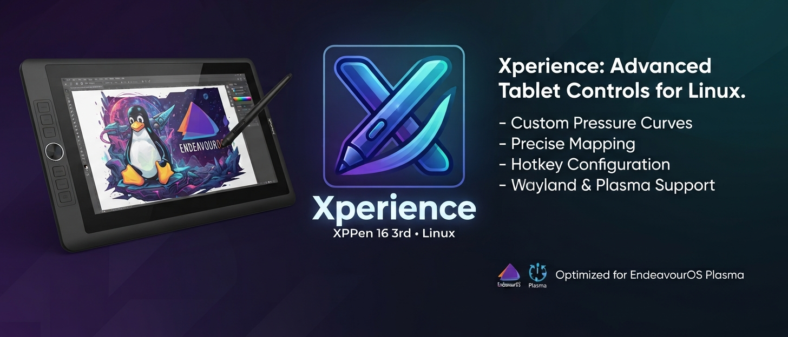

# Xperience

Linux support for the XPPen Artist 16 3rd pen display: a kernel driver for its keys, dials and pen, and a
settings app for everything the maker's own app offers.

**Status: early.** The settings app runs on KDE Plasma (Wayland) and is covered by tests. The driver builds and
passes its offline tests; it has not been run on a tablet yet, and neither has anything that depends on it.

## Settings app

`tools/build.sh` builds everything and refreshes `bin/`; `bin/xperience` opens the settings window.

- **Work area**: which monitor the pen works on (or all of them), any part of it, any part of the tablet's
  surface, each picked by dragging, by clicking its two corners or by numbers; a proportion button that keeps
  circles round; rotation in quarter turns; calibration by tapping five crosses.
- **Pen**: pressure curve with presets, a live reading and a patch to try it on; pressure and tilt on or off;
  smoothing; mouse mode and its speed; what each pen button does, including eraser while held and a
  pen/eraser switch.
- **Keys and dials**: every key takes a shortcut (one held, or several typed in a row), two shortcuts taking
  turns, a mouse action, a program to start, or a special action such as precision mode or switching monitor.
  Each dial has four functions that a key steps through. They start out as the maker assigns them, in the
  order the keys run as the tablet is held, whichever way it is turned.
- **Profiles** per application, a **floating menu** of eight buttons, on-screen hints, export and import,
  brightness of the tablet's screen.

The pen's mapping, rotation and pressure are stored by the desktop itself. Plain shortcuts and clicks are
handed to the desktop as its own tablet button bindings, so they work without Xperience running; the rest
(several shortcuts in a row, hints, dial switching, profiles, the floating menu) needs it in the background,
where it sits behind a tray icon.

`bin/xperience --status` prints what was found on this machine. While it runs, Xperience keeps a record of
what the tablet reports and what was done with it (each stroke's pressure, tilt and reach, every key, dial turn
and pen button) in `~/.local/state/xperience/xperience.log`; Settings shows where it is. It stays on the
computer.

[docs/PARITY.md](docs/PARITY.md) lists everything the maker's app offers for this tablet and where it is here.

## Driver

`driver/` is an HID-BPF program, loaded by [udev-hid-bpf](https://gitlab.freedesktop.org/libevdev/udev-hid-bpf).
Out of the box the tablet's keys and dials type fixed key combinations. With the program loaded the tablet
shows up as:

- a pen with 16383 pressure levels and tilt, its lower button a button and its upper button an eraser, as
  out of the box; either button can be set to be a button, an eraser while held, or a pen/eraser switch,
  and so can any of the tablet's keys; its positions can be smoothed
- a pad with 8 keys and 2 dials

The settings window installs and removes it (Settings, Driver); that asks for administrator rights and needs
the `udev-hid-bpf` package. Removing it puts the tablet back into the mode it comes in. The maker's own app
must not be running while the driver is in charge; with Xperience there is no need to keep it installed.

```
tools/build-driver.sh    # needs clang and the libbpf headers; writes bin/0010-XPPen__Artist16_3rd.bpf.o
tools/test.sh            # every test: the driver's, the install helper's and the app's; no root, no tablet
```

## Not here yet

Languages other than English, and tablets other than the Artist 16 3rd.

## License

Each file names its license. The driver and its tests are GPL-2.0-only (`LICENSES/GPL-2.0-only.txt`).
